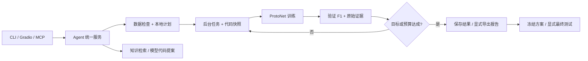

# NGC6517 Research Agent

面向 **NGC6517 脉冲星 / 射频干扰（RFI）二分类**的本地科研智能体：实验规划、训练执行、验证反馈、本地检索、模型代码提案和实验报告。

本项目包含两层：**科研智能体**组织研究流程；**多模态 ProtoNet**分类样本。默认本地模式无 API、Token、向量数据库或外部模型下载。大模型生成代码、假设与论文草稿作为可选扩展，本次暂缓凭据配置。

> 当前版本为工程重构版。未运行新训练、GPU 基准或端到端运行测试，不提供重构后的准确率或 F1 承诺。仓库不包含数据、权重、实际运行日志、密钥、论文 PDF 或提取全文。

## 阅读导航

- [系统定位：主控、研究角色和工具](#系统定位)
- [智能体角色总览与详细职责](#智能体角色与职责)
- [智能体之间如何协作](#智能体之间如何协作)
- [无需 API 时能做什么](#运行模式与当前接入状态)
- [已实现的主体](#已实现的主体) · [工作流程](#工作流程)
- [快速使用](#快速使用) · [数据放置](#数据放置)
- [代码结构](#代码结构) · [MCP 与可选大模型](#mcp-与可选大模型)
- [迁移与边界](#迁移与边界)

## 系统定位

这个项目可以理解为一个面向脉冲星分类的“小型科研团队”：主控负责安排研究任务，研究角色分别承担提出假设、设计模型、执行实验、分析结果、写作和评审，底层工具负责训练、检索、保存记录和管理代码版本。

当前实现采用**中心编排的模块化科研工作流**。下文按代码职责拆解为 10 类角色，其中有规则调度器、实验执行模块、搜索算法和 LLM 角色。这里的“角色”指不同职责与提示词入口，不代表已经部署了 10 个独立的大模型，也不代表 10 个进程会同时讨论或运行。

需要区分三种组成：

| 组成 | 在项目中做什么 | 代表实现 |
|---|---|---|
| 主控与研究角色 | 决定做什么实验、组织执行、提出或评议研究内容 | `Agent`、Idea、CodeGen、Experiment、Writeup、Review |
| 工具与执行基础设施 | 检查文件、训练模型、检索资料、保存证据、展示页面 | `data`、`runner`、`Store`、`CodeManager`、知识检索、CLI/Gradio/MCP |
| 被研究的分类模型 | 从观测数据提取特征，区分 Pulsar 与 RFI | `NGC6517Encoder` 和原型分类函数 |

默认入口运行本地规则计划与受管理的实验；LLM 研究角色已有模块入口，等待接入后按需调用。分类网络是实验对象，不承担科研主控或论文评审职责。

## 智能体角色与职责

### 角色总览

| 角色 | 扮演的身份 | 核心职责 | 代码入口 | 依赖方式 |
|---|---|---|---|---|
| 主控调度 / Orchestrator | 课题负责人、任务协调者 | 接收命令，检查能力，制定预算计划，提交和查询任务 | [service.py](ngc_agent/service.py) 的 `Agent`；[agent_orchestrator.py](skills/agent_orchestrator.py) 兼容入口 | 默认本地运行；开放式 LLM 对话待接入 |
| 研究假设 / Idea Agent | 提出研究问题的研究员 | 读取代码、已有结果和知识，生成可实验的假设；可做文献辅助的新颖性初筛 | [agent_ideas.py](skills/agent_ideas.py)：`generate_ideas()`、`check_idea_novelty()` | LLM；新颖性初筛还需联网检索 |
| 模型设计 / CodeGen Agent | 神经网络架构师、算法工程师 | 根据改进方向生成完整候选模型，维持训练接口，给出设计理由 | [code_generator.py](skills/code_generator.py)；`Agent.propose()` | LLM；手写提案无需 LLM |
| 实验执行 / Experiment Agent | 实验工程师 | 把候选代码变成受管理的训练任务，收集成功/失败记录和验证分数 | [agent_experiments.py](skills/agent_experiments.py)、[runner.py](ngc_agent/runner.py) | 本地训练无需 API；自动生成候选时需要 LLM |
| 结果分析 / Analysis Role | 实验分析员 | 汇总真实验证结果，标记证据不足，形成可追溯报告 | `analyze_experiment_results()`、[train_tools.py](skills/train_tools.py)、`Agent.report()` | 当前为本地规则和记录汇总 |
| 架构探索 / BFTS Explorer | 管理实验分支的搜索协调者 | 按验证分数选择未展开节点，生成结构变体，训练并维护实验树 | [agent_bfts.py](skills/agent_bfts.py)：`BFTSExplorer` | 搜索管理是算法；生成变体需要 LLM |
| 论文写作 / Writeup Agent | 科研写作者 | 根据实验日志、模型快照和相关资料分章节起草论文 | [agent_writeup.py](skills/agent_writeup.py)：`perform_writeup()`、`add_citations()` | LLM；文献补充可能联网 |
| 独立评审 / Reviewer Role | 模拟同行审稿人 | 从论文文本提出优点、问题、评分和修改意见，支持多次独立调用与反思 | [agent_review.py](skills/agent_review.py)：`perform_review()` | LLM |
| 元评审 / Meta-review Role | 领域主席、评审协调者 | 汇总多份评审，整理共识、分歧和修改建议 | 同文件：`get_meta_review()` | LLM |
| 论文修订 / Improvement Role | 修改稿编辑 | 按审稿意见改写论文，输出修订稿 | 同文件：`perform_improvement()` | LLM |

### 1. 主控调度：负责“谁来做、做多少、做到哪里停止”

- **输入**：用户命令、`TrainConfig`、目标验证 F1、实验次数预算、超时预算，以及可选的模型提案 ID。
- **处理**：检查数据和依赖；生成本地消融计划；向后台提交任务；提供查询、取消、最终评估、提案与报告接口。
- **输出**：结构化计划、任务 ID、任务状态、日志、报告或代码提案信息。
- **边界**：`Agent.chat()` 当前是明确命令的路由入口，支持 `/plan`、`/train`、`/run-plan`、`/search` 等；尚未实现任意自然语言驱动的大模型自动选工具。`skills/agent_orchestrator.py` 是兼容适配层，调度主体在 `Agent` 中。

本地主控计划的默认顺序是：**基线 → 先验门控消融 → Dropout 消融 → 学习率消融 → 不同种子重复**。例如 `budget=3` 只包含前三项，学习率项目从第四项开始。

### 2. 研究假设：负责“提出什么值得验证的问题”

- **输入**：当前模型代码、训练记录、领域知识、目标指标与此前生成的想法。
- **处理**：使用研究员提示词生成假设，并在配置的反思轮次内修订；`check_idea_novelty()` 可进一步调用 arXiv 检索，为候选做初筛。
- **输出**：包含 `Name`、`Title`、`Experiment` 以及可行性、趣味性、新颖性等模型自评分的结构化候选，保存到本地 `ideas.json`。
- **边界**：假设和评分是待验证的建议。`novel=True` 只是检索辅助下的模型判断，不能当作学术新颖性的证明；该角色不直接训练模型。

### 3. 模型设计：负责“把改进方向写成候选代码”

- **输入**：当前代码、验证表现、接口约束、领域知识和改进方向。
- **处理**：`generate_model_from_scratch()` 生成完整模型；`generate_model_variant()` 产生已有模型的变体；`generate_architecture_ideas()` 为结构搜索提出分支方向。统一服务的 `Agent.propose()` 则直接生成并暂存一个模型提案。
- **输出**：完整候选代码、设计说明、静态检查结果；走统一服务时还会生成提案 ID、校验和及差异文件。
- **边界**：生成器本身不提供性能保证。训练接口要求保留 `NGC6517Encoder(embed_dim, dropout, use_prior)` 与 `prototypical_logits()` 的主要调用参数；静态通过仍可能在实际张量或数值计算中出错。

例如“将图像分支中的一个卷积模块替换为深度可分离卷积，保持输入输出维度”可以作为提案方向。这只是使用示例，不表示仓库默认模型已经进行了该替换。

### 4. 实验执行：负责“实际运行并留下证据”

- **输入**：训练配置、手写或生成的提案，以及实验预算。
- **处理**：本地执行由 `Agent.submit()` / `run_plan()`、后台 worker 和训练子进程完成；可选 `perform_experiments()` 则把一条假设串联为生成提案、提交训练、等待结果和记录反馈的有限循环。
- **输出**：任务 ID、训练日志、源码快照、配置与清单摘要、权重、验证指标，以及失败信息。
- **边界**：实际梯度更新由 `train_fewshot.py` 完成。生成代码和执行训练是不同步骤；失败不会被填写成成功分数，候选训练也不会自动应用到当前 `model_proto.py`。

### 5. 结果分析：负责“总结观察，指出还缺什么证据”

- **输入**：真实任务结果、验证 F1、研究假设及已有实验记录。
- **处理**：读取和汇总结果；当前 `analyze_experiment_results()` 提取验证观察、标记证据不足，`evaluate_progress()` 查看目标差距，`Agent.report()` 按真实记录生成报告。
- **输出**：验证观察、目标状态、需要补充的证据说明，以及可追溯的 Markdown 报告。
- **边界**：当前分析是确定性的本地逻辑，不是另一个已经接入的 LLM 分析专家。仅凭 F1 不能断言过拟合、表征坍缩或某个模块产生了因果收益；这些结论需要对照实验、损失、混淆矩阵和重复种子支持。

### 6. 架构探索：负责“在候选结构之间分配搜索预算”

- **输入**：根节点模型代码、可选基线分数、最大深度、最大实验数及分支数。
- **处理**：BFTS（Best-First Tree Search，最佳优先树搜索）选择验证分数最高、训练成功且尚未展开的节点；调用设计模块生成变体，再通过统一训练服务评估子节点。
- **输出**：节点关系、每个候选的代码与分数、最佳节点、树摘要和本地 `bfts_tree.json`。
- **边界**：默认 `run-plan` 是顺序规则消融，**不会自动切换成 BFTS**。BFTS 需要显式创建 `BFTSExplorer` 并调用 `explore()`；需要应用所选代码时再显式调用 `restore_best_code()`。当前搜索类中的验证停止阈值为 0.90，不与 `run-plan --target-f1` 自动联动。

### 7. 论文写作：负责“把已有证据组织为论文草稿”

- **输入**：实验记录、研究假设、领域知识、相关文献及对应模型快照。
- **处理**：逐章节生成摘要、引言、相关工作、方法、实验、结论和参考文献；`add_citations()` 提供补充引用的入口。
- **输出**：本地 `ngc6517_paper.md`，以及章节、长度和输出路径等信息。
- **边界**：缺少真实实验日志时不生成性能结论。大模型草稿仍需检查原始指标、引用与每个章节的错误标记；`Agent.report()` 生成的本地实验报告与该 LLM 论文草稿是两个不同功能。

### 8. 独立评审：负责“从审稿视角寻找问题”

- **输入**：论文文本、模拟审稿人数和反思轮数。
- **处理**：为每位模拟审稿人建立独立调用历史，使用略有差异的生成温度，生成并反思各自的意见；随后调用元评审汇总。
- **输出**：带 `reviewer_id` 的评审列表、优缺点、评分、建议与元评审结果。
- **边界**：多位审稿角色通常仍调用同一配置的语言模型，不代表多种独立基础模型或真实人类专家。当前实现存在文本截断和解析失败的默认回退分支，必须连同 `error` / `raw_text` 一起阅读，不能把平均分当成可靠的录用预测。

### 9. 元评审：负责“综合评审意见并排列修改重点”

- **输入**：多份评审 JSON 或文本。
- **处理**：从领域主席提示词出发，归纳共识优点、共识不足和争议，给出修改建议。
- **输出**：`Meta_Summary`、`Consensus_Strengths`、`Consensus_Weaknesses`、`Conflicting_Views`、`Revision_Suggestions` 等字段，以及模型生成的评分和决定。
- **边界**：`perform_review()` 会调用它；也可以单独调用 `get_meta_review()`。它是评审汇总角色，不执行训练，不代表会议或期刊的真实决定。

### 10. 论文修订：负责“按照意见修改文字”

- **输入**：原论文与单份评审或元评审意见。
- **处理**：提取不足和修改建议，生成修订后的论文文本。
- **输出**：`ngc6517_paper_revised.md` 与修订文本、长度和路径。
- **边界**：`perform_improvement()` 修改的是论文文字，不会自动改网络结构或重新训练。若审稿意见要求补实验，仍需返回主控与实验执行流程，取得真实结果后再更新论文。

### 为这些角色提供支持的工具

| 工具 / 基础设施 | 为角色提供什么 | 对应代码 |
|---|---|---|
| 数据检查工具 | 清单格式、缺失文件、类别计数和划分交集 | [data.py](ngc_agent/data.py) |
| 本地知识工具 | 带来源的知识与论文片段检索 | [knowledge.py](ngc_agent/knowledge.py)、[rag_tools.py](skills/rag_tools.py) |
| 在线论文工具 | 显式 arXiv 搜索、下载；PDF 文本提取按需进行 | [paper_tools.py](skills/paper_tools.py)、`import_local_pdf()` |
| 代码版本工具 | 提案、差异、AST 检查、快照、备份及回滚 | [code.py](ngc_agent/code.py)、[code_tools.py](skills/code_tools.py) |
| 任务与实验记忆 | 持久化状态、事件、配置与结果引用 | [store.py](ngc_agent/store.py)、`.agent/` |
| 统一 LLM 客户端 | 共享模型调用接口、超时、有限重试和结构化内容提取 | [llm_client.py](skills/llm_client.py) |

这些工具是研究角色的执行能力，不应单独宣传成新的大模型智能体。持久化记忆主要是任务与实验记录，不是已经实现的长期对话语义记忆。

## 智能体之间如何协作

### 本地默认路径：已经接入统一入口

```text
用户给出配置、目标与预算
  → 主控检查数据和能力
  → 本地规划器给出有限的消融列表
  → 后台执行器逐轮训练并保存证据
  → 读取验证 F1，更新最佳结果
  → 达标、预算耗尽、取消或超时后停止
  → 用户显式导出报告
  → 冻结方案后，用户显式提交最终测试
```

这里自动串联的是计划范围内的训练与验证反馈。`run-plan` 不会自行发布论文、启动同行评审，也不会根据测试结果继续调参。

### LLM 研究路径：已有角色模块，按需显式串联

```text
Idea 提出假设
  → 文献工具辅助初筛
  → CodeGen 生成候选模型
  → Experiment 暂存并训练候选
  → Analysis 汇总真实结果
  → Writeup 起草论文
  → Reviewer 给出多份模拟评审
  → Meta-review 汇总意见
  → Improvement 生成修订稿
```

上图是已有模块可组成的研究链路，需调用方显式调度并检查每步结果。当前默认 CLI、网页和 MCP 入口尚未把全部 LLM 角色自动串成一键流程；API 配置也按项目当前约定暂缓。

`ai_scientist_pipeline.py` 的当前行为需特别说明：

- `run_ai_scientist()` 提交本地规则实验计划，返回任务 ID 和报告命令。
- `do_idea()` 调用可选的假设驱动实验模块，并导出记录报告。
- 保留的 `enable_writeup`、`enable_review` 参数目前没有自动调度论文写作或评审；需要显式调用对应角色函数。
- `perform_review()` 内部会聚合多位模拟审稿人的意见并调用 `get_meta_review()`；生成修订稿仍需显式调用 `perform_improvement()`。

### 角色之间传递什么

| 交接 | 传递的信息 | 保留的证据或标识 |
|---|---|---|
| 假设 → 设计 | `Name / Title / Experiment`、参考资料、当前模型与指标 | 假设记录、来源信息 |
| 设计 → 实验 | 完整候选代码、改动理由、训练配置 | 提案 ID、差异、源码校验和 |
| 实验 → 分析 | 成功/失败状态、验证指标、输出路径 | 任务 ID、事件、`summary.json`、日志 |
| 分析 → 写作 | 可核实的结果、配置、选中代码快照及局限 | 权重与报告路径、来源任务 |
| 写作 → 评审 | 论文 Markdown | 草稿文件、评审列表 |
| 评审 → 修订 | 元评审、具体修改建议、原论文 | 评审结果、修订稿 |

交接采用 Python 参数、JSON、数据库记录与文件路径。当前没有各角色自行广播的消息总线；独立训练任务受项目级单活动任务约束。

## 运行模式与当前接入状态

| 功能 | 无 API 凭据时 | 入口 / 说明 |
|---|---|---|
| 查看能力、数据检查、规则计划 | 可用 | `status`、`inspect`、`plan` |
| 训练、规则自动实验、最终评估 | 有本地数据与训练依赖后可用 | `train`、`run-plan`、`evaluate` |
| 本地文本检索、真实记录报告 | 可用 | `search`、`report` |
| 手写代码提案、差异、应用与回滚 | 可用 | `stage`、`apply`、`rollback` |
| 大模型生成模型提案 | 返回 `deferred` | `propose`；接入后走统一服务 |
| 假设生成、LLM 架构变体与 BFTS | 待接入 | `skills/` 中对应 Python 函数 / 类 |
| 论文草稿、评审、元评审、文字修订 | 待接入 | 对应角色函数；不随默认本地流程自动启动 |
| arXiv 搜索、下载 | 无需 LLM 密钥，但需网络及可选依赖 | 显式论文工具；本地搜索不会自动联网 |

“可用”表示该本地入口已实现及其依赖方式，不表示本版已经完成运行测试。LLM 角色共用 `llm_client.py` 的模型配置，通过不同提示词和调用历史区分职责；API 配置与整条 LLM 链路的运行验证均未在本次交付中进行。

## 已实现的主体

| 能力 | 实现 |
|---|---|
| 统一入口 | 命令行、Gradio、MCP 复用 `ngc_agent.service.Agent` |
| 本地规划 | 基线、先验门控消融、Dropout、学习率与种子重复；明确标记为规则规划 |
| 自动实验闭环 | 串行执行预算内的实验，按验证 F1 反馈并停止 |
| 任务管理 | 后台进程、持久化任务 ID、事件、取消、超时、中断标记、重跑 |
| 实验追溯 | 独立目录、源代码快照、配置、CSV 摘要、SHA256、命令与日志 |
| 数据检查 | 缺失文件、标签、样本数、重复路径与跨划分交集 |
| 评估隔离 | 验证 F1 选择检查点和阈值；最终测试单独显式执行 |
| 本地检索 | 文本词项检索，返回片段、来源及偏移位置；无需嵌入模型 |
| 模型修改 | 提案、差异、语法/接口检查、独立提案训练、备份与回滚 |
| 实验报告 | 依据真实记录生成 Markdown，缺失结果显示“未产生/未评估” |
| 可选 LLM 扩展 | 假设、代码生成、BFTS、草稿与审阅；凭据接入暂缓 |

## 工作流程



本地闭环是受预算约束的实验自动化，不把规则计划描述为大模型推理，也不把未经核实的解释描述为科研发现。

## 快速使用

使用 **Python 3.10+**，可以复用已有 PyTorch 环境。先激活自己的环境，任务将使用同一 Python 启动训练。

状态、规划、清单检查、本地检索和报告只依赖标准库。需要训练时补齐缺少的依赖：

```bash
python -m pip install -r requirements.txt
```

需要网页界面时：

```bash
python -m pip install -r requirements-ui.txt
python gradio_app.py
```

打开 `http://127.0.0.1:7860`，使用对话、实验管理、日志、检索、模型提案和报告页面。界面没有凭据配置表单。`gradio_dashboard.py` 也是此界面的兼容启动入口。

### 查看与规划

在项目根目录运行：

```bash
python agent.py status
python agent.py inspect --config configs/baseline.json
python agent.py plan --config configs/baseline.json --budget 3
python agent.py search "多尺度卷积"
```

缺少数据时检查会报告缺失，训练提交会被拒绝；规划和其他本地功能仍可使用。

### 训练与自动实验

下面是两种独立用法，一次只提交一个：

```bash
python agent.py train --config configs/baseline.json
python agent.py run-plan --config configs/baseline.json --budget 3 --target-f1 0.90
```

自动实验最多运行预算指定的项目，达到验证目标可提前停止，目标不保证达到。命令返回任务 ID 后后台继续运行。将 `JOB_ID` 替换为返回值：

```bash
python agent.py job JOB_ID
python agent.py logs JOB_ID
python agent.py events JOB_ID
python agent.py cancel JOB_ID
python agent.py report --job-id JOB_ID
```

每个项目只允许一个训练/搜索/评估任务。取消和超时由工作进程停止训练子进程。`status` 可找回历史任务。

### 冻结后最终评估

```bash
python agent.py evaluate JOB_ID
```

仅接受成功训练/搜索任务，使用所选权重、模型快照、配置与验证阈值，不重新训练；返回新的评估任务 ID。测试结果不反馈给规划器。

最终测试采用 **2-way episodic few-shot** 协议：在测试划分内部抽取互不重叠的支持集和查询集。这不同于没有标注支持集的直接部署评估，详见 [数据与评估](docs/DATA_AND_EVALUATION.md)。

### 手写模型提案

```bash
python agent.py stage my_candidate_model.py --reason "替换编码模块做对照"
python agent.py train --config configs/baseline.json --proposal PROPOSAL_ID
```

`stage` 返回提案 ID、代码位置和 `changes.diff`。先阅读代码及差异，再训练。提案训练使用独立快照；需要改当前模型时再显式应用：

```bash
python agent.py apply PROPOSAL_ID
python agent.py rollback BACKUP_SHA256
```

备份标识由应用结果返回。静态检查不执行代码，不证明其数值正确或安全；候选训练是本地 Python 执行，并非沙箱。

## 数据放置

```text
NGC6517/                  # 本地 .npz 样本
splits1/
  train.csv
  val.csv
  test.csv                # 仅最终评估需要
papers/                   # 可选 PDF
papers_extracted/         # 可选提取文本
knowledge/                # 可选自有 Markdown / TXT 笔记
```

CSV 至少包含 `packed_path` 和 `label_bin`（兼容 `label_int` 或 `label`），`0=RFI`、`1=脉冲星`。参考 [格式示例](examples/split.example.csv)，其中是占位内容，并非训练数据。每个使用的划分、每个类别至少需要 `k_shot + q_shot` 个有效样本。

NPZ 包含 `profile`、`dm_curve`、`subints`、`subbands`。旧格式支持对象数组，只读取可信本地文件。相对路径便于 Windows / Linux 迁移。

## 代码结构

```text
agent.py                    # 命令行
ngc_agent/
  config.py                 # 参数验证与命令构建
  service.py                # 统一服务、规划、提案与报告
  runner.py                 # 后台训练、预算循环、取消和超时
  store.py                  # SQLite 任务与事件
  data.py                   # 无训练依赖的清单检查
  code.py                   # 提案、AST 检查、备份和回滚
  knowledge.py              # 无模型文本检索
model_proto.py              # 多模态先验门控 ProtoNet
dataset_ngc6517.py          # 预处理、诊断特征、批次组装
train_fewshot.py            # episodic 训练与最终评估
gradio_app.py               # 网页控制台
train_mcp_server.py         # MCP 工具
skills/                     # 可选 LLM 研究模块、兼容适配器
configs/baseline.json       # 默认配置
docs/                       # 架构、评估协议、运行说明
```

分类模型为 Profile 1D CNN、DM 1D CNN、图像 2D CNN、元数据 MLP 四路编码，经融合输出归一化嵌入，再以原型余弦相似度分类。27 维诊断特征用于分支门控。详见 [架构与方法](docs/ARCHITECTURE.md)。

## MCP 与可选大模型

```bash
python -m pip install -r requirements-agent.txt
python train_mcp_server.py
```

MCP 使用 stdio，应由客户端启动管理；训练日志写入任务文件，不占用协议输出。工具包括检查、计划、训练、查询/取消、评估、检索、报告和提案。

当前 MCP 工具主要向宿主助手提供以下能力：

| 工具组 | 工具名称 |
|---|---|
| 观察与规划 | `agent_status`、`inspect_data`、`plan_experiments` |
| 实验执行 | `start_training`、`start_experiment_plan`、`evaluate_frozen_model` |
| 任务控制 | `get_job`、`get_job_logs`、`get_job_events`、`cancel_job`、`retry_job`、`recover_interrupted_job` |
| 资料与报告 | `search_local_knowledge`、`search_arxiv`、`export_report` |
| 模型代码 | `stage_model_code`、`read_model_proposal`、`apply_model_proposal`、`rollback_model`、`propose_model_change` |

MCP 是工具协议入口。使用它的宿主助手可以围绕任务调用工具；该协议本身不新增一个研究角色。Idea、Writeup、Review 等可选模块目前通过 Python 函数调用，未全部注册为 MCP 工具。

`python agent.py propose "改进方向"` 在未接入时返回 `deferred`。客户端不自动读取或执行旧 `.env.py`，不预设个人部署地址。LLM、arXiv、PDF 与向量扩展按需导入；本地检索不下载嵌入模型。`requirements-agent.txt` 只安装可选库，不包含凭据。

## 迁移与边界

- 旧日志和输出保留在本地；新实验写入 `.agent/`，不自动导入旧测试选择协议的结果。
- `retry` 创建新任务，不恢复优化器状态；`recover` 标记工作进程已退出的中断任务。
- 本次未新增或运行测试，也未启动训练；进行了 Python 语法静态检查及发布范围检查。依赖范围不是经过全组合验证的锁定环境。
- 默认本地单用户使用，尚未实现远程认证、容器执行隔离、分布式调度或科研新颖性证明。
- `.gitignore` 排除真实数据、权重、凭据、论文全文和运行状态。公开内容仅为代码、配置模板、格式示例与文档。

更多：[架构与方法](docs/ARCHITECTURE.md) · [数据与评估](docs/DATA_AND_EVALUATION.md) · [运行与恢复](docs/OPERATIONS.md) · [改动说明](CHANGELOG.md)
