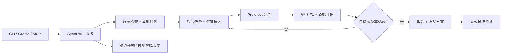

# NGC6517 Research Agent

面向 **NGC6517 脉冲星 / 射频干扰（RFI）二分类**的本地科研智能体：实验规划、训练执行、验证反馈、本地检索、模型代码提案和实验报告。

本项目包含两层：**科研智能体**组织研究流程；**多模态 ProtoNet**分类样本。默认本地模式无需 API、Token、向量数据库或外部模型下载。大模型生成代码、假设与论文草稿作为可选扩展，本次暂缓凭据配置。

> 当前版本为工程重构版。未运行新训练、GPU 基准或端到端运行测试，不提供重构后的准确率或 F1 承诺。仓库不包含数据、权重、实际运行日志、密钥、论文 PDF 或提取全文。

## 已实现的主体

| 能力 | 实现 |
|---|---|
| 统一入口 | 命令行、Gradio、MCP 复用 `ngc_agent.service.Agent` |
| 本地规划 | 基线、先验门控消融、Dropout、学习率与种子重复；明确标记为规则规划 |
| 自动实验闭环 | 串行执行预算内的实验，按验证 F1 反馈并停止 |
| 任务管理 | 后台进程、持久化任务 ID、事件、取消、超时、中断标记、重跑 |
| 实验追溯 | 独立目录、源代码快照、配置、CSV 摘要、SHA256、命令与日志 |
| 数据检查 | 缺失文件、标签、样本数、重复路径与跨划分交集 |
| 评估隔离 | 验证 F1 选择检查点和阈值；最终测试单独显式执行 |
| 本地检索 | 文本词项检索，返回片段、来源及偏移位置；无需嵌入模型 |
| 模型修改 | 提案、差异、语法/接口检查、独立提案训练、备份与回滚 |
| 实验报告 | 依据真实记录生成 Markdown，缺失结果显示“未产生/未评估” |
| 可选 LLM 扩展 | 假设、代码生成、BFTS、草稿与审阅；凭据接入暂缓 |

## 工作流程



本地闭环是受预算约束的实验自动化，不把规则计划描述为大模型推理，也不把未经核实的解释描述为科研发现。

## 快速使用

使用 **Python 3.10+**，可以复用已有 PyTorch 环境。先激活自己的环境，任务将使用同一 Python 启动训练。

状态、规划、清单检查、本地检索和报告只依赖标准库。需要训练时补齐缺少的依赖：

```bash
python -m pip install -r requirements.txt
```

需要网页界面时：

```bash
python -m pip install -r requirements-ui.txt
python gradio_app.py
```

打开 `http://127.0.0.1:7860`，使用对话、实验管理、日志、检索、模型提案和报告页面。界面没有凭据配置表单。`gradio_dashboard.py` 也是此界面的兼容启动入口。

### 查看与规划

在项目根目录运行：

```bash
python agent.py status
python agent.py inspect --config configs/baseline.json
python agent.py plan --config configs/baseline.json --budget 3
python agent.py search "多尺度卷积"
```

缺少数据时检查会报告缺失，训练提交会被拒绝；规划和其他本地功能仍可使用。

### 训练与自动实验

下面是两种独立用法，一次只提交一个：

```bash
python agent.py train --config configs/baseline.json
python agent.py run-plan --config configs/baseline.json --budget 3 --target-f1 0.90
```

自动实验最多运行预算指定的项目，达到验证目标可提前停止，目标不保证达到。命令返回任务 ID 后后台继续运行。将 `JOB_ID` 替换为返回值：

```bash
python agent.py job JOB_ID
python agent.py logs JOB_ID
python agent.py events JOB_ID
python agent.py cancel JOB_ID
python agent.py report --job-id JOB_ID
```

每个项目只允许一个训练/搜索/评估任务。取消和超时由工作进程停止训练子进程。`status` 可找回历史任务。

### 冻结后最终评估

```bash
python agent.py evaluate JOB_ID
```

仅接受成功训练/搜索任务，使用所选权重、模型快照、配置与验证阈值，不重新训练；返回新的评估任务 ID。测试结果不反馈给规划器。

最终测试采用 **2-way episodic few-shot** 协议：在测试划分内部抽取互不重叠的支持集和查询集。这不同于没有标注支持集的直接部署评估，详见 [数据与评估](docs/DATA_AND_EVALUATION.md)。

### 手写模型提案

```bash
python agent.py stage my_candidate_model.py --reason "替换编码模块做对照"
python agent.py train --config configs/baseline.json --proposal PROPOSAL_ID
```

`stage` 返回提案 ID、代码位置和 `changes.diff`。先阅读代码及差异，再训练。提案训练使用独立快照；需要改当前模型时再显式应用：

```bash
python agent.py apply PROPOSAL_ID
python agent.py rollback BACKUP_SHA256
```

备份标识由应用结果返回。静态检查不执行代码，不证明其数值正确或安全；候选训练是本地 Python 执行，并非沙箱。

## 数据放置

```text
NGC6517/                  # 本地 .npz 样本
splits1/
  train.csv
  val.csv
  test.csv                # 仅最终评估需要
papers/                   # 可选 PDF
papers_extracted/         # 可选提取文本
knowledge/                # 可选自有 Markdown / TXT 笔记
```

CSV 至少包含 `packed_path` 和 `label_bin`（兼容 `label_int` 或 `label`），`0=RFI`、`1=脉冲星`。参考 [格式示例](examples/split.example.csv)，其中是占位内容，并非训练数据。每个使用的划分、每个类别至少需要 `k_shot + q_shot` 个有效样本。

NPZ 包含 `profile`、`dm_curve`、`subints`、`subbands`。旧格式支持对象数组，只读取可信本地文件。相对路径便于 Windows / Linux 迁移。

## 代码结构

```text
agent.py                    # 命令行
ngc_agent/
  config.py                 # 参数验证与命令构建
  service.py                # 统一服务、规划、提案与报告
  runner.py                 # 后台训练、预算循环、取消和超时
  store.py                  # SQLite 任务与事件
  data.py                   # 无训练依赖的清单检查
  code.py                   # 提案、AST 检查、备份和回滚
  knowledge.py              # 无模型文本检索
model_proto.py              # 多模态先验门控 ProtoNet
dataset_ngc6517.py          # 预处理、诊断特征、批次组装
train_fewshot.py            # episodic 训练与最终评估
gradio_app.py               # 网页控制台
train_mcp_server.py         # MCP 工具
skills/                     # 可选 LLM 研究模块、兼容适配器
configs/baseline.json       # 默认配置
docs/                       # 架构、评估协议、运行说明
```

分类模型为 Profile 1D CNN、DM 1D CNN、图像 2D CNN、元数据 MLP 四路编码，经融合输出归一化嵌入，再以原型余弦相似度分类。27 维诊断特征用于分支门控。详见 [架构与方法](docs/ARCHITECTURE.md)。

## MCP 与可选大模型

```bash
python -m pip install -r requirements-agent.txt
python train_mcp_server.py
```

MCP 使用 stdio，应由客户端启动管理；训练日志写入任务文件，不占用协议输出。工具包括检查、计划、训练、查询/取消、评估、检索、报告和提案。

`python agent.py propose "改进方向"` 在未接入时返回 `deferred`。客户端不自动读取或执行旧 `.env.py`，不预设个人部署地址。LLM、arXiv、PDF 与向量扩展按需导入；本地检索不下载嵌入模型。`requirements-agent.txt` 只安装可选库，不包含凭据。

## 迁移与边界

- 旧日志和输出保留在本地；新实验写入 `.agent/`，不自动导入旧测试选择协议的结果。
- `retry` 创建新任务，不恢复优化器状态；`recover` 标记工作进程已退出的中断任务。
- 本次未新增或运行测试，也未启动训练；进行了 Python 语法静态检查及发布范围检查。依赖范围不是经过全组合验证的锁定环境。
- 默认本地单用户使用，尚未实现远程认证、容器执行隔离、分布式调度或科研新颖性证明。
- `.gitignore` 排除真实数据、权重、凭据、论文全文和运行状态。公开内容仅为代码、配置模板、格式示例与文档。

更多：[架构与方法](docs/ARCHITECTURE.md) · [数据与评估](docs/DATA_AND_EVALUATION.md) · [运行与恢复](docs/OPERATIONS.md) · [改动说明](CHANGELOG.md)
