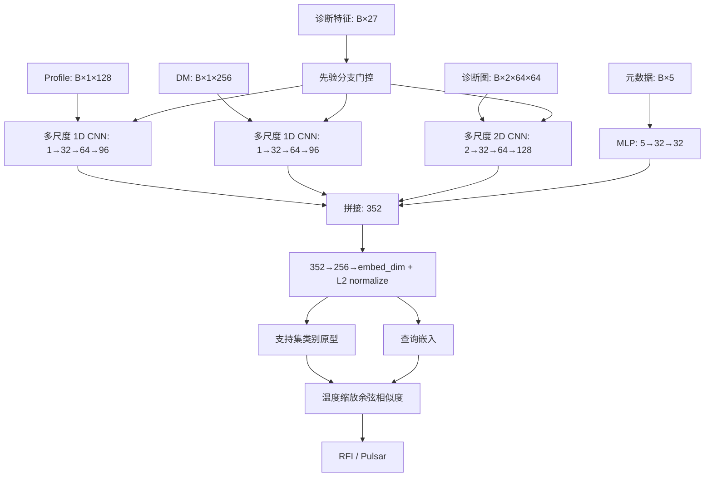

# 智能体架构与分类方法

0.3.0 新增 LangGraph 主工作流：`ngc_agent/workflow.py` 定义数据检查、检索、规划、训练提交、等待、分析和报告节点，使用 `SqliteSaver` 保存图状态。详见 [LangGraph 节点与恢复](LANGGRAPH.md)。下文分类模型保持原结构。

## 1. 为什么是智能体项目

外层系统具有目标、计划、工具、实验记忆和反馈：接收研究任务，建立有限计划，执行训练，读取验证证据，判断是否继续，保存实验记录并输出报告。原项目已具备这些模块的原型，本版把执行路径和记录系统统一。

默认运行的是**规则规划驱动的科研智能体**。它不依赖语言模型，计划内容和执行边界透明。大模型接入后可以扩展假设、代码与文字草稿；没有凭据时这些能力返回待接入状态。

## 2. 服务与模块

| 模块 | 职责 | 导入时是否需要外部服务 |
|---|---|---|
| `Agent` | 统一接口、计划、提交、提案、报告 | 否 |
| `ResearchWorkflow` | LangGraph 节点、条件边、检查点、后台工作流 | 需本地 LangGraph 依赖，无需外部服务 |
| `TrainConfig` | 字段和数值范围，生成参数列表 | 否 |
| `Store` | SQLite 事务、持久任务、事件和单活动任务约束 | 否 |
| `runner` | 独立工作进程、训练子进程、预算循环 | 否 |
| `data` | CSV、文件、标签、计数、划分交集 | 否 |
| `knowledge` | 分词、词频加权、局部文本片段检索 | 否 |
| `CodeManager` | 提案、差异、AST、校验和、备份、回滚 | 否 |
| `skills/llm_client.py` | 显式配置的兼容接口、限次重试和超时 | 仅实际调用时 |
| `skills/paper_tools.py` | 显式在线 arXiv 检索/下载 | 仅实际调用时 |

命令行、Gradio 和 MCP 是同一服务的三个适配层。Gradio 会轮询状态和最近日志；MCP 工具提交后立即返回任务 ID。参考 [Gradio Timer](https://gradio.app/docs/gradio/timer) 与 [FastMCP 工具文档](https://gofastmcp.com/servers/tools)。

## 3. 执行与反馈

提交前验证配置和数据。接受后复制训练脚本、加载器、模型及数据检查代码到 `.agent/runs/<id>/source/`，记录 SHA256，然后启动独立工作进程。工作进程启动训练子进程，记录命令与输出；每轮实验用自己的目录。

自动实验按照有限消融计划串行运行。每轮读取 `summary.json`，只有进程正常结束、权重存在、验证 F1 有效且未意外执行测试时，才接纳结果。失败记录保留，可继续预算内的其他候选；达到验证目标则提前停止。

默认前四项分别是基线、切换先验门控、增加 Dropout、减半学习率，其余为基线的不同随机种子。它是固定顺序的规则计划，不是贝叶斯优化或语言模型自适应搜索。多轮搜索的墙钟超时在整个任务上共享。

## 4. 分类模型

### 4.1 四路编码

| 分支 | 卷积或投影 | 聚合后的维数 |
|---|---|---:|
| Profile | 每块并行核 3、7、15；拼接后 BN、ReLU、池化，共三块 | 96 |
| DM | 与 Profile 相同，但独立参数 | 96 |
| 图像 | 每块并行核 3×3、5×5、7×1、1×7；前两块池化 | 128 |
| 元数据 | Linear(5,32)、ReLU、Linear(32,32) | 32 |

融合层：`Linear(352,256) → BatchNorm → ReLU → Dropout → Linear(256,embed_dim)`；默认 `embed_dim=128`，输出 L2 归一化。

### 4.2 先验引导门控

27 维诊断向量分为 Profile 9 维、DM 8 维、图像 10 维。线性层为各块各分支生成门控：

`gate = 1 + 0.2 × tanh(W × prior + b)`

W、b 初始化为 0，因此初始缩放为 1。`--no_prior` 关闭该机制，用作消融。它是本项目已有的结构设计，未在本次重构中测量收益。

### 4.3 原型与多原型

默认对支持集中每个类的归一化嵌入取均值，再归一化为类原型。查询评分：

`logit_c = temperature × cosine(z_query, prototype_c)`

训练以两个类别的交叉熵优化编码器；分类概率由 softmax 给出。`psr_k/rfi_k > 1` 时，采用确定性远点优先选择支持集代表向量，类别得分取查询与该类代表向量的最大相似度，未实施迭代聚类。

原型分类思想参考 [Snell 等：Prototypical Networks for Few-shot Learning](https://arxiv.org/abs/1703.05175)。本项目的编码器、归一化余弦评分和固定二分类任务有自己的配置，不能直接套用原论文的性能结论。

## 5. 模型提案与可选 BFTS

`stage` 将候选完整代码写入提案目录，保存基线/候选校验和和统一差异。AST 检查要求编码器及原型函数存在，且保留训练器调用的主要参数。它不会导入或执行候选代码。

候选可以直接以独立快照训练，当前模型文件保持可用。`apply` 检查基线是否改变，并保留内容寻址备份；`rollback` 通过指定备份 SHA256 恢复。

`skills/agent_bfts.py` 保留可选的最佳优先树搜索：节点为模型代码和验证分数，选择未展开且已训练成功的最高分节点，由 LLM 生成子分支。代码与节点结果写入树记录。它需要 API 接入，不在默认离线计划中；候选训练也走统一任务系统。

科研流程设计可参考 [The AI Scientist](https://arxiv.org/abs/2408.06292)，本项目并未复现其完整系统，也不将 BFTS 名称当作已验证性能的依据。

## 6. 当前边界

- 代码提案的静态检查不是执行沙箱，也不能证明张量形状或数值正确。
- 本地检索是词项相似度，中文使用二字片段，不是语义向量检索。
- 任务支持取消和全任务墙钟预算；没有 GPU 显存配额或跨项目调度。
- 源码和 CSV 清单有哈希，未逐个计算所有 NPZ 数据文件的哈希。
- 此版没有重新训练或评估，不声明模型更准、更快或参数更少。
