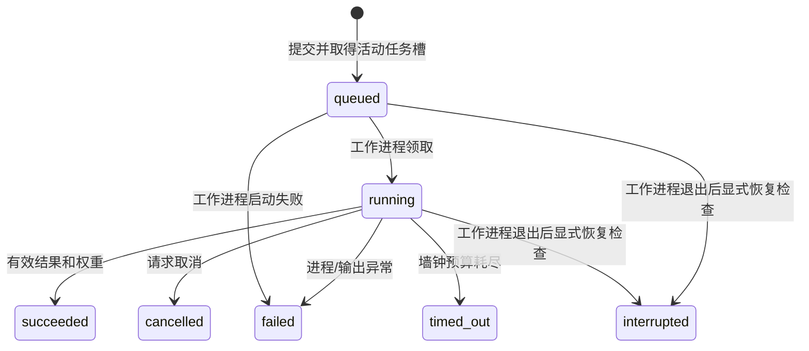

# 运行、任务状态与恢复

0.3.0 的 LangGraph 主入口、节点、数据暂停、检查点恢复与取消见 [工作流运行说明](LANGGRAPH.md)。本文其余命令仍适用于底层独立训练任务。工作流 ID 与训练任务 ID 不同。

## 1. 入口与依赖

| 入口 | 命令 | 依赖 |
|---|---|---|
| 本地状态/规划/检索/报告 | `python agent.py ...` | 标准库 |
| LangGraph 科研工作流 | `python agent.py workflow-start` | requirements-workflow.txt |
| 训练 | `python agent.py train` | requirements.txt |
| 网页控制台 | `python gradio_app.py` | requirements-ui.txt |
| MCP | `python train_mcp_server.py` | requirements-agent.txt；训练工具另需训练依赖 |

项目要求 Python 3.10+。所有入口使用当前解释器启动子进程，应先激活自己已有的 PyTorch 环境。依赖文件按功能分组，不在本次工作中更改用户的现有环境。

MCP 使用 [FastMCP stdio 运行方式](https://gofastmcp.com/deployment/running-server)，由客户端启动脚本。日志写到任务文件；本地核心没有 import-time API 请求或向量模型下载。

## 2. 状态机



取消是请求标记，不会在 UI 中立刻伪造“已取消”。工作进程轮询标记，停止自己持有的训练子进程后记录终态。每个项目至多一个活动任务，SQLite 唯一索引防止并发提交抢占同一项目。

训练单次和自动计划共享配置中的 `timeout_seconds`；自动计划的预算对整个任务生效，不是每轮重新计时。

## 3. 文件布局

```text
.agent/
  state.sqlite3
  runs/<JOB_ID>/
    manifest.json
    worker.log
    source/                 # 源码快照
    console.log             # 单次训练/最终评估
    summary.json
    history.json
    model.pt
    progress.json           # 自动计划的阶段证据
    trial_01/               # 自动计划每轮独立输出
      trial_manifest.json
      console.log
      summary.json
      history.json
      model.pt
  proposals/<PROPOSAL_ID>/
    proposal.json
    model_proto.py
    changes.diff
  backups/<SHA256>.py
  reports/
```

不是所有文件在所有任务中都存在。最终评估引用源任务权重，不生成新的训练权重；失败与取消任务可能只有部分日志。不要把未完成输出当成功结果。

## 4. 常用恢复操作

```bash
python agent.py status
python agent.py job JOB_ID
python agent.py logs JOB_ID
python agent.py cancel JOB_ID
```

关闭浏览器或原命令窗口通常不会停止后台任务。需要停止时使用 `cancel`。

若电脑关机或工作进程异常退出，任务可能仍显示活动。确认工作进程已退出后：

```bash
python agent.py recover JOB_ID
python agent.py retry JOB_ID
```

`recover` 检查进程是否仍存活，存活时拒绝标记中断。若工作进程已退出而训练子进程仍残留，需要先人工结束或等待该进程，再恢复；系统不会按不明来源的历史 PID 强行杀进程。

`retry` 创建新的任务 ID，复用旧任务模型快照和配置，从头训练；不是优化器状态续训，也不会自动跳过已完成的计划项。旧记录继续保留。

## 5. API 与线上功能暂缓

本版不填写密钥、不自动读取旧 `.env.py`、不替用户配置任何服务地址。状态中会标记大模型功能待接入，其他本地工具可独立使用。

以后若接入，客户端支持显式参数或 `AGENT_MODEL / AGENT_BASE_URL / AGENT_API_KEY`，并兼容既有 DASHSCOPE 对应环境变量。没有三项完整配置时不调用外部服务。请勿把实际值写入 GitHub。

arXiv 搜索和 PDF 下载是显式在线工具；PDF 提取需要 pypdf。向量辅助函数是外部扩展接口，不是本地检索依赖；只有已安装的本地嵌入模型可加载。

## 6. 发布与运行边界

只发布代码、说明、配置模板和占位格式示例；`.env*`、真实 CSV、NPZ、权重、PDF、全文文本库、向量库和 `.agent/` 都排除。

网页默认仅绑定 `127.0.0.1`，没有认证和多用户隔离。不应直接将其作为公网多人服务。候选模型是可执行 Python，AST 检查不等于隔离执行。

此次交付只进行了源代码静态检查和发布清单检查；没有新增或运行测试，也未训练模型或测量 GPU 性能。新环境的依赖兼容和实际运行仍需后续验证。
